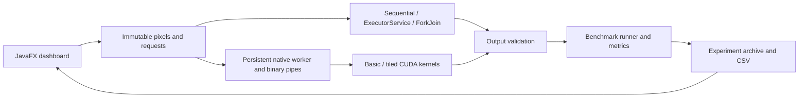

# Parallel VisionLab project report and demo handoff

## Objective and delivered application

Parallel VisionLab is a JavaFX desktop laboratory for the semester's Parallel and
Distributed Computing project. It applies the same image operations through
sequential Java, ExecutorService, Fork/Join, and a separate NVIDIA CUDA executable.
Basic and shared-memory tiled CUDA convolution are selectable. The user interface
follows the supplied six-page HTML reference, implemented with native JavaFX
controls rather than a browser wrapper.

The implemented core includes image loading/inspection, grayscale, Gaussian blur,
Sobel, sharpen/general convolution, backend controls, immutable input/output,
correctness validation, repeated benchmarks, charts, persistent history, CSV/PNG
export, runtime telemetry, saved defaults and portable Windows packaging.

## Architecture

CPU kernels operate on disjoint output rows and share immutable input. Executor
tasks join before output publication. Fork/Join recursively splits row ranges;
Sobel waits for the grayscale stage before gradients. Pools are reused and closed
on reconfiguration/exit. CUDA uses persistent processes with framed binary pipes,
input/device buffer reuse, a request timeout and response version/dimension checks.
Workers close when their owner finishes; no JNI is used.

## Correctness and algorithms

The shared contract is in [filter-contract.md](filter-contract.md). Borders
replicate the nearest valid pixel. Alpha is preserved exactly. Grayscale uses
fixed integer weights; convolution uses ordered double accumulation, rounding
and clamping. Gaussian kernels are normalized; Sobel computes Euclidean gradient
magnitude from reference grayscale. CUDA disables fused multiply-add for closer
agreement. CPU outputs must match exactly; GPU accepts at most one RGB level of
error, while alpha must still match exactly.

Tests include known colors, orientation, hand-calculated borders, constant/impulse
images, narrow and odd dimensions, partial GPU tiles, all operations, parameter
validation, overflow, ownership, interruption and pool/process lifecycle. Every
benchmark output is compared outside the timed interval before results are saved.

## Example measurement on the development machine

The committed [benchmark-example.csv](benchmark-example.csv) is a real run, not
illustrative data. It was collected on November 18, 2026 using a deterministic
512×512 opaque gradient, Gaussian radius 2, sigma 1.2, 3 warmups and 5 measured
iterations. CPU parallelism was 16; Fork/Join leaf threshold 32.

Environment: 21.0.12.1 Java, Windows 11 amd64.
Hardware metadata: logical_processors=16; CPU=AMD64 Family 25 Model 68 Stepping 1, AuthenticAMD; GPU=NVIDIA GeForce RTX 4050 Laptop GPU.
Native development: CUDA 13.5.37 and MSVC 19.51 on Windows; actual GPU tests ran on
an NVIDIA GeForce RTX 4050 Laptop GPU. Raw UTC timestamp, image SHA-256, source
identifier, min/max, throughput and validation scopes are retained in the CSV.

| Backend | Median wall time ms | Baseline speedup | CPU efficiency | CUDA kernel ms |
| --- | ---: | ---: | ---: | ---: |
| Sequential Java | 20.718 | 1.000x | 100.0% | N/A |
| Java Multithreading | 3.739 | 5.541x | 34.6% | N/A |
| Java Fork/Join | 3.549 | 5.838x | 36.5% | N/A |
| CUDA GPU — Basic Kernel | 183.992 | 0.113x | N/A | 1.181 |
| CUDA GPU — Tiled Kernel | 180.417 | 0.115x | N/A | 1.276 |

CPU rows measure the engine call, including allocations/scheduling/synchronization.
GPU rows in this historical run measure the executable bridge, including process/context startup,
files and transfers. CUDA event times are reported separately and must not be
presented as equivalent end-to-end speedups. Efficiency applies only to configured
CPU workers; GPU efficiency is not defined as speedup divided by CUDA core count.

This run demonstrates substantial native-process overhead on a small input. It
does not establish that the tiled variant is always faster: its kernel can be
slower for small images, small filters, or particular hardware conditions. The
original file bridge made this tradeoff visible. The current implementation uses
a persistent native worker with binary pipes and cached immutable input. Current
results have a different timing scope and must not be substituted into this
historical table. The opt-in CudaWorkflowBenchmarkTest compares both transports
in the same session; its CSV is written under target.

## Reproduction and evaluation plan

1. Run setup.ps1 -InstallNative -NoLaunch on the development Windows machine.
2. Run the full Maven suite with visionlab.uiTests=true and visionlab.cudaTests=true.
3. Run package.ps1 and use the bundled runtime's --self-test command.
4. Reproduce the deterministic example with --benchmark-demo results.csv.
5. In the UI, benchmark several real images at multiple resolutions, each filter,
   and worker counts 1/2/4/8/16, using the same input/options on all backends.
6. Export CSV and retain image hashes, parameter sets, scopes and min/max ranges.
   Repeat trials in a quiet system; do not generalize from the one supplied image.

Warmups are not a guarantee of full JVM stabilization. Backend order is fixed;
GC, other workloads, clock/power/temperature and OS scheduling can affect results.
A broader repeated dataset is still needed for a final scientific performance study.

## Demonstration sequence

- Overview: show real engine availability and recorded comparison.
- Workspace: load image, zoom/fit, switch four filters and all available backends;
  explain Gaussian parameters, worker controls and Fork/Join threshold.
- Save a full-resolution PNG; show original pixels remain unchanged.
- Benchmark Lab: warmups/repetitions, validation, metrics and GPU event scopes.
- History: reopen saved records and export measured CSV.
- Monitor: detected CPU/JVM activity and real NVIDIA load/VRAM/power/temperature.
- Settings: save defaults; restart and confirm restoration.
- Portable build: show native Windows launcher and bundled Java; explain optional
  NVIDIA driver requirements and CPU operation without CUDA hardware.

## Remaining release checks and limits

Core implementation and automated hardware checks are complete. A full manual
walkthrough of every native file-dialog/error state and installation on a genuinely
separate Windows computer are not claimed. The no-display packaged-runtime checks
verify bundled dependencies but do not replace that separate-machine test.

CPU per-core utilization and CPU power/temperature are unavailable in this build
and are explicitly labeled. Native GPU calls start a fresh process each time.
Custom kernel editing, video/batch workflows, cloud services, and image-operation
undo are outside the core semester scope. History uses bounded/versioned local
files, not a multiuser database. The generic convolution API is exposed in code;
the UI offers the sharpen preset.
